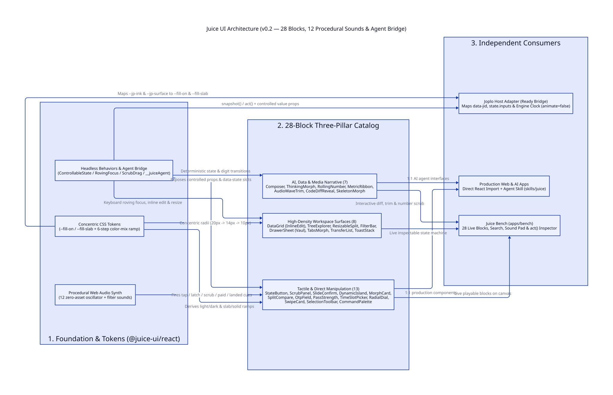

# Juice UI (`@tokenroll/juice` & `@tokenroll/juice-vue`)

**Juice UI** is a standalone, domain-agnostic, high-craft UI & micro-interaction library by **TokenRollAI** with **86 live blocks**, **182 exported primitives**, concentric `color-mix` tokens, and a 3KB zero-asset Web Audio synth across React 18/19 and Vue 3.

- **Official Website & Live 86-Block Playground**: https://juice-ui.pages.dev *(custom domain ready: `juice.tokenroll.ai`)*
- **React Package**: `@tokenroll/juice` (`packages/juice`)
- **Vue 3 Package**: `@tokenroll/juice-vue` (`packages/vue`)
- **AI Agent Skill**: `npx skills add TokenRollAI/juice` (`skills/juice/SKILL.md`)

## Highlights

1. **Concentric `color-mix` Craft & 3KB Web Audio Synth** *(inspired by [bencho.dev](https://bencho.dev/))* — Zero border noise. A 6-step tonal ramp derived from `--fill-on` and `--fill-slab` that automatically steps up in dark/solid fills, paired with `320px` card rhythm, `20px → 14px → 10px` concentric geometry, and 12 zero-asset Web Audio procedural sounds (`tap`, `latch`, `pop`, `scrub`, `tick`, `paid`, `landed`, `deny`, `lift`, `drop`, `swipe`, `chime`).
2. **Full Radix Primitives + Base UI + Studio Workbench + Deep AI Agents**:
   - **Everyday Foundation, Radix & Base UI (30 blocks)**: Full WAI-ARIA keyboard roving, typeahead, 3-state indeterminate `CheckboxGroup`, compound `Field` / `Fieldset` / `Form`, `Autocomplete`, `ScrubNumberField`, `ContextMenu`, `Menubar`, `NavigationMenu`, `ToggleGroup` + `Toolbar`, `AlertDialog`, `ScrollArea`, `AspectRatio`, `DualRangeSlider`, `Collapsible`, `Meter`, `Progress`, `PreviewCard`.
   - **Portal, Floating & Studio Primitives (14 blocks)**: Collision-aware `placeFloating` & `FloatingPopover` (fullscreen-safe), `HoverPreviewList`, `BreadcrumbDropdownBar`, width-collapsing `AdaptiveToolbar`, `SwatchPreviewMatrix` with hover preview & rollback, non-blocking `FloatingInspectorSheet`, inline-editable `DataGrid`, `TreeExplorer`, `ResizableSplit`, `DrawerSheet`.
   - **Media, Timeline & Workbench Primitives (6 blocks)**: `MediaTransportDock` (`StepTimeline`), `IdleFullscreenPill`, 4-corner magnetic `DraggableSnapOrb`, SVG `ProgressRing` + `BackgroundTaskMenu`, `CopySnippetFlash`, and `MaskedSecretManager`.
   - **Deep AI Chat & Agentic Workflows (23 blocks)**: `SlashMentionComposer`, `ModelEffortPicker`, `ThinkingMorph`, `GroundedAnswer`, `MessageBranchThread`, `VisionRegionAsk`, `VoiceOrbSession`, `ArtifactCanvas`, `ToolApprovalGate` (HITL), `AgentPlanChecklist`, `TerminalStreamCard`, `SubagentSwarmBoard`, `McpServerRoster`, `ContextBudgetMeter`, `AgentMemoryStore`, `ModelArenaCompare`, `RateLimitBanner`.
3. **Headless Behaviors & Agent Bridge** — Composable `useControllableState`, `useScrubDrag`, `useRovingFocus`, and `window.__juiceAgent` (`snapshot()`, `act()`, `query()`) plus `<JuiceProvider animate={false}>` for deterministic frame capture.



## Installation

### React 18 / 19
```bash
pnpm add @tokenroll/juice lucide-react
```

```tsx
import '@tokenroll/juice/styles.css';
import { JuiceProvider, StateButton, SlashMentionComposer } from '@tokenroll/juice';

export function App() {
  return (
    <JuiceProvider defaultTheme="light" defaultFill="slab" defaultSound={true}>
      <StateButton id="deploy-action" amount={420} />
      <SlashMentionComposer id="agent-composer" />
    </JuiceProvider>
  );
}
```

### Vue 3
```bash
pnpm add @tokenroll/juice-vue
```

### AI Agent Skill (Antigravity, Claude Code, Codex)
```bash
npx skills add TokenRollAI/juice
```

## Workspace Structure

- `packages/juice` (`@tokenroll/juice`): Core CSS tokens, Web Audio procedural synth, headless behaviors & agent bridge (`./core`), and 86 blocks + 182 exported primitives.
- `packages/vue` (`@tokenroll/juice-vue`): Native Vue 3 composition hooks and components sharing the same token ramp and `window.__juiceAgent` protocol.
- `apps/bench` (`@tokenroll/juice-site`): Official Juice UI Website, Documentation, API Matrix, Tokens/Sound Lab & 86-Block Playground — built 100% with Juice UI components.
- `skills/juice/SKILL.md`: Agent skill definition.

## Local Development

```bash
pnpm install
pnpm dev            # Official website & Playground at http://localhost:4320
pnpm build          # Build @tokenroll/juice, @tokenroll/juice-vue, and website
pnpm typecheck
pnpm test
```

## License

MIT © TokenRollAI
